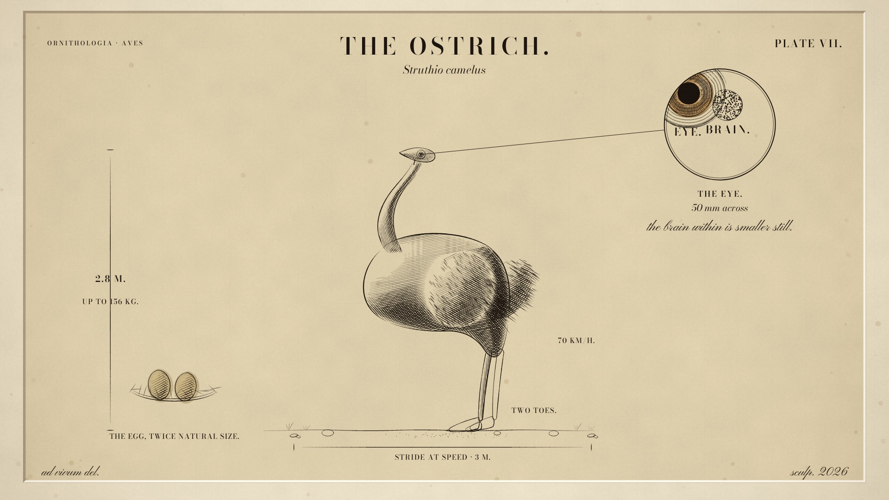

# The Ostrich, Plate VII — a documentary short, made entirely in code

**Struthio camelus**, engraved, scored and narrated by an AI agent. A ~58-second
nature documentary in the **Copperplate Engraving** style of the
[Lemo-Opuscar](https://github.com/lemomo-ai/lemo-opuscar) film library: a
19th-century natural-history plate that engraves itself — outline, three passes
of hatching, dimension labels, a magnification roundel on the eye, a proof pulled
off the copper, hand-coloured eggs, and the finished plate.

> It cannot fly. It has never needed to.

[](../../releases/download/v1.0.0/ostrich-plate.mp4)

**Watch / download:** [Release v1.0.0](../../releases/tag/v1.0.0) — `ostrich-plate.mp4`
(1920×1080, 24 fps, −14 LUFS) with subtitles (`ostrich-plate.srt`) and the poster.

## How it was made

No video generation, no stock footage. Every frame is drawn by code:

- **Picture** — `ostrich.js` (the bird, authored as SVG paths and analytic tone
  fields) + `film.js` (the 88 BPM timeline, camera, transitions) + the
  engraving engine from Lemo-Opuscar (`engine/`). Rendered frame by frame at
  24 fps in headless Chrome, 1391 frames.
- **Voice** — Kokoro (`bm_george`) narration, verified word-for-word with
  faster-whisper; word timestamps drive the subtitles.
- **Music** — an original 88 BPM score: harpsichord + lute while lines are cut,
  harp at the film's turn to D major, recorder on the finished plate
  (VCSL samples, CC0; nylon-string lute by physical modelling).
- **Sound** — procedural foley from the page's event list: burin hiss and swarf,
  hatch micro-scratches, the press rumble, paper peel, brush and nest scratches.
  Two real silences: the eye beat and the drying of the wash.
- **Mix** — ducked under the narration, mastered to −14 LUFS with ffmpeg loudnorm.

The film's only colour arrives at its emotional peak: the amber iris inside the
eye roundel, and the cream of the eggs.

## Rebuild it

Needs Node 20+, ffmpeg, Python 3.11+, and the Lemo-Opuscar library:

```sh
git clone https://github.com/lemomo-ai/lemo-opuscar
cd lemo-opuscar && sh plugin/skills/lemo-opuscar/scripts/setup.sh deps voice music
sh tools/fetch.sh instruments vcsl

LIB=/path/to/lemo-opuscar sh /path/to/this/folder/build.sh
```

`build.sh` runs the whole studio: TTS → speech check → events → score → mix →
1391 frames → mux → checks → subtitles → poster.

## Repository secrets

- `NVIDIA_NIM_API_KEY` — NVIDIA NIM API key, stored as an Actions secret for
  future automation (not used by the build itself).

## Files

| file | what |
|---|---|
| `ostrich-plate.mp4` (in Releases) | the film |
| `poster.jpg` | the finished plate |
| `ostrich-plate.srt` | subtitles |
| `TREATMENT.md` | the director's treatment: structures, shot list, cue map, sound design |
| `ostrich.js`, `film.js`, `main.js`, `engine/` | the picture: subject, timeline, page, engraving engine |
| `lines.json`, `voices/` | narration script and audio |
| `music/score.py`, `mix.py` | the score and the final mix |
| `timeline.json`, `events.json`, `cues.json` | the single timeline driving picture, score, foley and subtitles |
| `CREDITS` | every third-party asset and its licence |
| `build.sh` | one-command rebuild |

## Licence

The film and its source: CC0 by the maker. Third-party assets keep their own
licences — see `CREDITS` (fonts: OFL; samples: CC0; Kokoro: Apache-2.0).
The engraving engine is from [Lemo-Opuscar](https://github.com/lemomo-ai/lemo-opuscar) (MIT).
